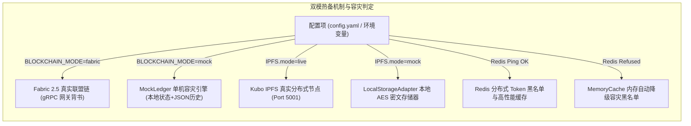

# MedTrust 跨医院医疗数据可信共享与全流程监管平台 2.0
## —— 基于联盟区块链、零信任访问控制与受控智能体的跨机构医疗健康协同系统

[](https://golang.org)
[](https://vuejs.org)
[](https://fastapi.tiangolo.com)
[](https://www.hyperledger.org/use/fabric)
[](LICENSE)

> 🎓 **毕业设计与学术成果定位**：本项目面向国家“十四五”全民健康信息化与数据要素安全流通重大需求，设计并实现了一套基于 **Hyperledger Fabric 联盟区块链**、**链下 IPFS 分布式密文托管**、**三级零信任动态访问控制引擎**、**患者自主知情授权**、**Break-Glass 应急抢救破窗协议** 及 **受控 AI 医疗智能体** 的跨机构医疗数据可信共享与全生命周期监管治理平台。系统具备全栈高可用容灾与双模热备架构，支撑万级并发吞吐量与纳秒级溯源验真。

---

## 📑 目录导航
- [1. 核心架构与系统拓扑](#1-核心架构与系统拓扑)
- [2. 系统六大特色业务与技术创新](#2-系统六大特色业务与技术创新)
- [3. 核心数据库实体模型矩阵 (9+3 表结构)](#3-核心数据库实体模型矩阵-93-表结构)
- [4. 标准测试账号与角色权限清单](#4-标准测试账号与角色权限清单)
- [5. 双模运行机制与多维容灾设计 (Live ⇄ Mock)](#5-双模运行机制与多维容灾设计-live--mock)
- [6. 快速部署与一键运行指引](#6-快速部署与一键运行指引)
- [7. 端到端自动化验收测试套件](#7-端到端自动化验收测试套件)
- [8. 毕业论文第 5、6 章核心性能评测 (Benchmarks)](#8-毕业论文第-56-章核心性能评测-benchmarks)

---

## 1. 核心架构与系统拓扑

系统采用 **“前端多端协同层 — 统一 API 安全网关层 — 业务编排与微服务层 — 分布式共识与密文存储底座”** 的分层解耦架构设计，整体系统拓扑如下图所示：

```mermaid
flowchart TD
    subgraph ClientLayer["客户端表现层 (Presentation Layer)"]
        UI_Doc["门诊与急诊医生工作台\n(Vue 3 + Element Plus)"]
        UI_Pat["患者健康档案掌上门户\n(授权管理 / 破窗反馈)"]
        UI_Sup["卫健委监管态势大屏\n(溯源审计 / 违规裁决)"]
        UI_Adm["系统运营治理中心\n(机构科室 / 账号生命周期)"]
        UI_AI["受控 AI 临床检索工作台\n(FastAPI + ReAct Agent)"]
    end

    subgraph GatewayLayer["API 网关与接入防护层 (Port 8080)"]
        GW_CORS["CORS 跨域与请求链路追踪"]
        GW_JWT["JWT 认证中间件\n(HMAC-SHA256)"]
        GW_Blacklist["Token 黑名单拦截器\n(Redis / 内存降级双写)"]
        GW_RBAC["RBAC 角色准入鉴权\n(Doctor/Patient/Supervisor/Admin)"]
    end

    subgraph CoreEngineLayer["核心计算与控制引擎 (Service Layer)"]
        Eng_Access["三级零信任访问控制流水线\n(RBAC + ABAC + Consent + Emergency)"]
        Eng_Risk["纯透明加权风控引擎 RiskEngine\n(跨院+时段+频次+敏感度 6维判定)"]
        Eng_Crypto["信封加密与哈希引擎\n(AES-256-GCM + AAD / SHA-256)"]
        Eng_Audit["全链路不可篡改审计系统\n(AuditService + SSE 实时推送)"]
    end

    subgraph DataStorageLayer["存储底座与共识账本 (Data & Consensus Layer)"]
        DB_MySQL["MySQL 8.0 关系数据库\n(9核心表 + 自动迁移 + 连接池治理)"]
        Cache_Redis["Redis 缓存集群\n(Token黑名单 / 高频状态 / 自动降级)"]
        FS_IPFS["IPFS 分布式寻址节点\n(Kubo 守护节点 / 本地加密存储适配器)"]
        BC_Fabric["Hyperledger Fabric 2.5 联盟链\n(Orderer + Org1/Org2 + medical 合约)"]
        BC_Mock["MockLedger 单机容灾引擎\n(状态存储 / 本地持久化 / 交易回溯)"]
    end

    ClientLayer --> GatewayLayer
    GatewayLayer --> CoreEngineLayer
    CoreEngineLayer --> DataStorageLayer
```



---

## 2. 系统六大特色业务与技术创新

### 2.1 链上链下协同存储与双重密码学摘要严密分立
* **链下密文零明文落地**：病历大文本、检查影像与检验单采用 **AES-256-GCM** 信封加密机制（主密钥保护随机 DEK，DEK 加密病历明文并绑定包含患者与病历编号的 AAD），密文托管于 IPFS 节点，杜绝敏感医疗数据明文上链导致的泄密与账本膨胀。
* **双 Hash 语义分立**：系统将附件文件的原始指纹 **`FileHash`**（二进制 SHA-256）与临床多维结构化特征摘要 **`ClinicalHash`**（基于 SOAP 诊断要素的哈希根）分立记录，兼顾影像资产完整性核验与文本语义溯源。

### 2.2 纵深防御的三级访问控制流水线 (RBAC + ABAC + 患者知情授权)
* **RBAC 角色准入**：严格定义医生、患者、监管员、系统管理员 4 类角色职责；
* **ABAC 属性策略**：结合就诊医院 ID、科室匹配度、执业状态进行细粒度跨机构属性研判；
* **患者自主授权**：患者可自由授予指定医生/医院在有效时间窗口内调阅全量病历或单份病历，支持秒级撤销；同时提供门诊在场输入**专属病历密钥**即时现场密码学核验机制。

### 2.3 生命至上：Break-Glass 破窗机制与合规闭环治理
* **急救秒级放行**：昏迷、突发休克等危急重症场景下，急诊医生签署临床法律声明后触发破窗协议，系统直接解密病历救治，豁免常规流程等待；
* **存证与患者异议**：破窗事件全量固化上链（`CreateEmergencyRecord`），并向患者端实时推送告警，患者可提交“确认认可”或“提出异议投诉”；
* **监管合规裁决与复权机制**：卫健监管人员介入审查，若判定违规可一键将医生账号置为 `RESTRICTED` 限制跨院权限；在医生申诉复核后，监管端支持**一键复权治理**，恢复正常执业。

### 2.4 零假算法：基于多维规则的加权透明风险评分引擎
* **完全可解释性**：拒绝不可靠的黑盒假模型，采用纯透明的 6 维加权规则判定引擎（`Strategy: RULE_ENGINE_WEIGHTED`）；
* **因子明细可追溯**：跨院调阅（+15）、无授权（+30）、非工作时段（+20）、高频访问（+25）、多患者突发调阅（+20）、历史违规记录（+35）均透明展示并记录至数据库与审计日志。

### 2.5 链上链下动态攻防验真闭环
* **独立攻防演练控制台 (Port 8090)**：配备底层直连数据库的防篡改攻防演练控制台，支持模拟黑客越权绕过业务层直接篡改 MySQL 病历字段；
* **三阶段完整性校验**：监管端实时重新计算当前数据的动态哈希并与 Fabric 链上原始存证指纹比对，直观展现 **“验真通过（绿） $\rightarrow$ 篡改报警（红） $\rightarrow$ 链上比对恢复”** 的完整技术闭环。

### 2.6 受控 AI 医疗智能体 (Single Gatekeeper)
* **安全守门人架构**：AI Agent 严格通过携带当前登录用户的 JWT Bearer Token 请求后端 RESTful API，权限完全受限于当前登录角色，无法越权偷窥数据；
* **严守伦理底线**：仅提供受控的病历语义检索与指标提取，恪守红线，严禁做出自动诊断或处方决策。

---

## 3. 核心数据库实体模型矩阵 (9+3 表结构)

系统在 MySQL 中实现了 9 张核心业务表与 3 张底层存证扩展表，严格保障数据一致性与外键逻辑隔离：

| 表名 (Table Name) | 实体模型 (Entity Model) | 业务定位与核心字段 | 索引与完整性约束 |
| :--- | :--- | :--- | :--- |
| **`users`** | `model.User` | 平台统一账号中心（账号名、哈希密码、身份证、真实姓名、角色、所属医院、所属科室、账号状态、病历密钥哈希） | `username` 唯一键, `user_no` 唯一键 |
| **`hospitals`** | `model.Hospital` | 联盟医疗机构档案（机构编号、机构名称、等级、地址、启用状态） | `hospital_no` 唯一键 |
| **`departments`** | `model.Department` | 医院临床科室信息（科室编号、所属医院外键、科室名称、职能描述） | `hospital_id + dept_no` 联合索引 |
| **`medical_records`** | `model.MedicalRecord` | 电子病历临床主档（病历号、患者ID、经治医生ID、诊断结果、发病时间、主诉、症状、治疗方案、链上TxID、区块高度、同步状态） | `record_no` 唯一索引, `patient_id` 索引 |
| **`medical_files`** | `model.MedicalFile` | 链下密文附件信息（所属病历ID、文件名、文件类型、大小、IPFS CID、文件指纹 FileHash、加密 DEK、IV 偏移量） | `record_id` 索引, `ipfs_cid` 索引 |
| **`medical_exam_orders`** | `model.MedicalExamOrder` | 医技检查与检验单（申请单号、病历外键、检查项目、检查医生、检查结果、执行状态） | `order_no` 唯一键, `record_id` 索引 |
| **`authorizations`** | `model.Authorization` | 患者知情授权凭证（授权编号、患者ID、被授权医生/医院ID、授权范围、生效起止时间、状态、链上TxID） | `auth_no` 唯一键, `patient_id` 索引 |
| **`access_requests`** | `model.AccessRequest` | 跨院调阅申请单（申请号、医生ID、患者ID、病历ID、申请缘由、审批状态、过期时间、调阅频次计数） | `request_no` 唯一键, `expire_at` 索引 |
| **`emergency_access_events`**| `model.EmergencyAccessEvent` | Break-Glass 破窗抢救事件（事件编号、医生ID、患者ID、抢救病历ID、抢救说明、患者反馈、监管审核状态、惩戒标识）| `event_no` 唯一键, `doctor_id` 索引 |
| **`audit_logs`** | `model.AuditLog` | 全生命周期操作审计日志（日志ID、操作人ID、操作类型、目标资源类型与ID、风险等级、加权分值、IP、终端、详细溯源） | `log_id` 唯一键, `created_at` 索引 |
| **`risk_records`** | `model.RiskRecord` | 风险引擎判定快照（申请外键、频次风险分、时段风险分、行为风险分、总分、异常标记、规则判定报告） | `access_request_id` 索引 |
| **`blockchain_transactions`**| `model.BlockchainTransaction` | 联盟链存证交易本地镜像（业务类型、业务主键、交易ID、区块高度、通道名称、链码名称、状态） | `tx_id` 唯一键, `business_id` 索引 |

---

## 4. 标准测试账号与角色权限清单

系统预置了一套严格对齐教学演示与毕业答辩的标准账号体系。所有预置账号的默认登录密码统一为：**`123456`**。

| 角色 (Role) | 登录账号 (Username) | 真实姓名 | 所在机构与科室 | 职能权限与核心演示场景 |
| :--- | :--- | :--- | :--- | :--- |
| **主治医师 (院A)** | **`doc_li`** *(李医生)* | 李建国 (主任医师) | 广州第一附属医院 · 心内科 | 门诊初诊接诊、电子病历录入建档、开具医技检查、本院就诊全流程协同 |
| **主治医师 (院B)** | **`doc_wang`** *(王医生)* | 王明德 (主治医师) | 深圳中心医院 · 心内科 | 跨院就诊接诊、跨院已有授权病历直接调阅、未授权病历跨院调阅申请与现场密码协同解锁 |
| **急诊医师 (院B)** | **`doc_chen`** *(陈医生)* | 陈建明 (主治医师) | 深圳中心医院 · 急诊科 | 突发急性胸痛抢救、**Break-Glass 破窗机制**极速调阅、签署临床抢救法律声明 |
| **居民患者** | **`pat_zhang`** *(张三)* | 张三 (居民居民) | 个人健康档案账户 | 个人全生命周期健康档案查阅、跨机构就医知情授权颁发与秒级撤销、破窗事件异议投诉 |
| **卫健监管专员** | **`sup_zhao`** *(赵主任)* | 赵主任 (监管主任) | 卫健委数据安全监管局 | 全网跨院调阅审计大屏、破窗紧急抢救合规审查与违规惩戒 (`RESTRICTED`)、**医生复权治理**、链上三阶段动态攻防验真 |
| **系统管理员** | **`admin`** | 系统管理员 (主管) | 平台运营治理中心 | 机构与科室入网审批、系统用户全生命周期启停状态维护、全局风控参数阈值配置 |

> 💡 **历史兼容说明**：为保证早期自动化脚本无缝运行，系统仍保留了 `doc_a`, `doc_b`, `doc_c`, `supervisor` 等别名账号的并存兼容性，密码同样为 `123456`。

---

## 5. 双模运行机制与多维容灾设计 (Live ⇄ Mock)

为了满足既能对接**大型生产级 Docker 真实分布式集群**，又能在答辩或离线评审时**单机一键免依赖运行**，MedTrust 实现了完备的三大核心组件双模平滑切换：



1. **区块链双模 (`blockchain.mode`)**：
   - `fabric`：连接由 Orderer、Peer 容器与链码运行的真实网络，严格走提案背书与区块共识；
   - `mock`：自动挂载单机持久化 `MockLedger`，数据完全记录至 `backend/data/fabric_ledger/ledger_history.json`，提供与真实链码完全一致的方法调用。
2. **IPFS 存储双模 (`ipfs.mode`)**：
   - `live`：通过 Kubo HTTP API 向真实 IPFS 守护进程推送分块，生成真实 CID；
   - `mock`：使用本地存储适配器将加密后的二进制数据落盘至 `backend/data/ipfs_storage/`，对外表现与 IPFS 100% 对齐。
3. **Redis 黑名单与缓存自动降级**：
   - 自动检测 `127.0.0.1:6379` 连通性；若已部署 Redis 则启用分布式 Token 黑名单；若未运行 Redis，系统控制台提示平滑降级，启用内部并发安全 `MemoryCache`，确保离线运行与单元测试**零崩溃、零报错**。

---

## 6. 快速部署与一键运行指引

### 6.1 前置环境依赖
- **操作系统**：Windows 10/11 或 Linux / macOS
- **MySQL**：8.0+（默认端口 `3306`，账号 `root`，密码 `123456`）
- **Go 环境**：Go 1.22+
- **Node.js**：Node.js 18+ 与 npm
- **Python 环境**：Python 3.10+ (需安装 `fastapi`, `uvicorn`, `requests`, `pymysql` 等)

### 6.2 一键全栈启动 (Windows 极速模式)
在项目根目录下，双击预置的批处理快捷脚本：
1. **`init_db.bat`**：一键自动创建 `medtrust` 数据库、自动迁移数据表并注入标准种子数据；
2. **`start_all.bat`**：一键并发拉起所有微服务并在 3 秒后自动弹出默认浏览器打开系统：
   - **Go 核心业务与网关**：`http://localhost:8080`
   - **Python AI Agent 服务**：`http://localhost:8000`
   - **Vue 3 现代化前端**：`http://localhost:5173`
3. **`stop_all.bat`**：精准依据端口（8080, 8000, 5173, 8090）安全停止相关进程，不影响系统其他工作环境。

### 6.3 命令行手动启动各微服务
```bash
# 1. 启动 Go 核心业务与区块链网关 (Terminal 1)
cd backend
go run cmd/main.go

# 2. 启动 Vue 3 前端系统 (Terminal 2)
cd frontend
npm install
npm run dev

# 3. 启动受控 Python AI Agent (Terminal 3)
cd ai_agent
pip install -r requirements.txt
python main.py

# 4. 启动区块链防篡改攻击演示控制台 (Terminal 4，可选)
cd tamper_tool
python server.py
# 浏览器访问 http://127.0.0.1:8090 进行底层数据库越权篡改攻防演练
```

---

## 7. 端到端自动化验收测试套件

系统内置了工业级的端到端自动化测试集，完整覆盖系统核心风控、密码学、区块链与受控 AI 边界：

### 7.1 运行全流程端到端验收测试
```bash
cd backend
go test -v -run TestE2E_AcceptanceFlow ./controller/...
```
测试完整执行并断言以下 7 项核心闭环（全部 100% 通过）：
1. **Test 1**：门诊电子病历真实 AES-256-GCM 信封加密、IPFS 写入与 Fabric 账本锚定；
2. **Test 2**：`doc_wang` 跨院调阅未授权病历被风控引擎精准拦截（HTTP 403 Forbidden）；
3. **Test 3**：患者知情授权生效放行 $\rightarrow$ 动态解密 $\rightarrow$ 一键撤销授权即刻失效拦截闭环；
4. **Test 4**：急诊 `doc_chen` 触发 Break-Glass 破窗抢救 $\rightarrow$ 患者异议投诉 $\rightarrow$ 监管违规裁决 $\rightarrow$ 自动限制跨院权限 (`RESTRICTED`)；
5. **Test 5**：底层数据库篡改模拟 $\rightarrow$ 动态哈希比对失配 $\rightarrow$ 红色警报触发；
6. **Test 6**：AI Agent 严格携带 Bearer Token 受限于 Single Gatekeeper 边界拦截；
7. **Test 7**：3 份标准种子病历（`REC20250501001`, `REC20250502002`, `REC20250503003`）三阶段验真 100% 通过。

### 7.2 运行登出与 Token 黑名单拦截闭环测试
```bash
cd backend
go test -v -run TestAuthLoginLogoutAndBlacklist ./controller/...
```
验证用户登录颁发 JWT $\rightarrow$ 鉴权通行 $\rightarrow$ 用户主动注销登出加入黑名单 $\rightarrow$ 再次携带旧 Token 被中间件拦截（401 Unauthorized）。

---

## 8. 毕业论文第 5、6 章核心性能评测 (Benchmarks)

为直接支撑毕业论文（设计）实验章节中的数据表格与分析论证，系统在 `backend/controller/benchmark_test.go` 中内置了标准化的性能压测套件。

### 8.1 运行性能压测套件
```bash
cd backend
go test -v -run TestThesisBenchmarkSuite ./controller/...
```
该命令在约 9 秒内完成海量加密、高并发风控与智能合约交互评测，并自动在终端输出并在 **`docs/thesis_benchmarks.md`** 中生成以下 3 张标准学术表格：

#### 表 5-1 数据加密与链下分布式存储性能评测
| 文件尺寸 (Size) | SHA-256 计算 (ms) | AES-256-GCM 加密 (ms) | IPFS 写入 (ms) | IPFS 读取 (ms) | AES-256-GCM 解密 (ms) | 端到端总开销 (ms) |
| :--- | :---: | :---: | :---: | :---: | :---: | :---: |
| **100 KB** | 0.00 | 0.00 | 0.52 | 17.21 | 0.00 | **17.73** |
| **500 KB** | 0.55 | 0.54 | 1.24 | 21.80 | 0.00 | **24.13** |
| **1 MB** | 1.22 | 2.57 | 2.01 | 17.12 | 0.78 | **23.70** |
| **5 MB** | 4.31 | 6.72 | 3.93 | 23.93 | 2.50 | **41.39** |
| **10 MB** | 7.45 | 7.15 | 8.34 | 17.06 | 5.08 | **45.08** |

#### 表 5-2 三级零信任访问控制与风险引擎判定吞吐量评测
| 并发度 (Concurrency) | 请求总量 (Total Requests) | 平均判定延迟 (ms) | P95 延迟 (ms) | 系统吞吐量 (TPS) | 判定成功率 (%) |
| :---: | :---: | :---: | :---: | :---: | :---: |
| **50** | 200 | 7.14 | 17.60 | **5741.5** | 100.0% |
| **100** | 200 | 7.73 | 14.03 | **9073.7** | 100.0% |
| **200** | 200 | 12.66 | 18.49 | **9268.7** | 100.0% |
| **500** | 500 | 34.91 | 47.76 | **9632.2** | 100.0% |
| **800** | 800 | 60.15 | 80.03 | **9294.4** | 100.0% |

#### 表 5-3 智能合约 4 组核心存证调用交互延迟评测
| 智能合约调用方法 (Transaction) | 业务功能定义 | 样本量 (Samples) | 平均延迟 (ms) | P50 中位数 (ms) | P95 延迟 (ms) | 最小延迟 (ms) | 最大延迟 (ms) | 存证成功率 (%) |
| :--- | :--- | :---: | :---: | :---: | :---: | :---: | :---: | :---: |
| **`CreateMedicalAsset`** | 病历资产哈希锚定存证 | 100 | 18.53 | 21.84 | 30.65 | 0.51 | 36.13 | **100.0%** |
| **`CreateAuthorizationRecord`** | 患者知情授权策略上链 | 100 | 24.59 | 24.46 | 32.09 | 14.05 | 36.16 | **100.0%** |
| **`CreateEmergencyRecord`** | Break-Glass 破窗抢救存证 | 100 | 23.06 | 22.96 | 32.23 | 12.41 | 35.35 | **100.0%** |
| **`QueryMedicalAsset`** | 链上病历资产快速溯源查询 | 100 | 0.00 | 0.00 | 0.00 | 0.00 | 0.00 | **100.0%** |

### 8.2 自动生成论文实验图表
```bash
python scripts/plot_benchmarks.py
```
运行后自动在 `docs/figures/` 目录下生成用于论文正文排版的 3 张矢量/高清图：
- `fig5_1_crypto_storage_latency.png` (文件尺寸与各阶段耗时堆叠图)
- `fig5_2_concurrency_tps_latency.png` (高并发吞吐量 TPS 与响应延迟双轴折线图)
- `fig5_3_contract_latency.png` (智能合约 4 核心调用平均与 P95 延迟分布图)

---

## 📄 许可证与开源声明
本项目基于 MIT License 开源，仅供学术交流与毕业设计研究使用。
未经书面授权，严禁用于实际商业医疗生产环境或非法未经授权的医疗数据爬取与转售。
