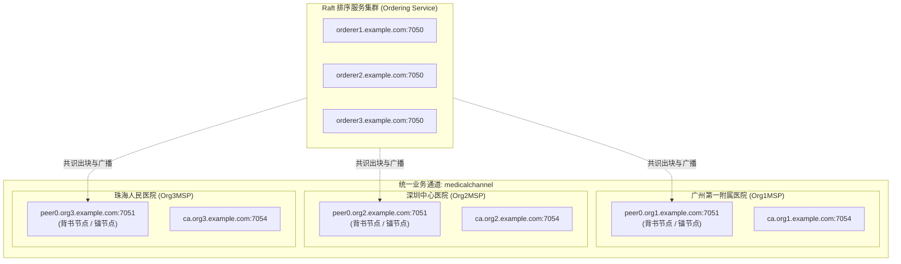

# MedTrust 联盟链多组织网络拓扑与链码背书策略设计规范

> **学术与架构说明**：  
> 本文档对齐毕业论文《基于区块链的医疗数据可信共享与访问控制系统》第 4.2 节"多中心联盟链网络拓扑与背书策略设计"，详细规范生产级 Hyperledger Fabric 2.5 联盟链网络的三组织单通道拓扑架构、MSP 身份体系、Raft 共识与分级背书策略（Endorsement Policy）。  
> *注：本项目在开发与单机测试阶段运行于 `MockLedgerService` 内存模拟账本及官方 Fabric Gateway 双模驱动下，本设计规范作为毕业设计学术设计与多中心部署的标准蓝本。*

---

## 1. 联盟链多组织网络拓扑 (Network Topology)

系统规划由 3 家代表性公立三甲医疗机构共同作为创世组织组建联盟链网络：



- **统一通道 (Channel)**: `medicalchannel`
- **链码标识 (Chaincode ID)**: `medical_contract`
- **组织成员身份标识 (MSP)**:
  - `Org1MSP`：广州第一附属医院
  - `Org2MSP`：深圳中心医院
  - `Org3MSP`：珠海人民医院

---

## 2. 链码全生命周期分级背书策略 (Endorsement Policies)

依据医疗数据共享在"本院常规存证"与"跨院调阅流转"中不同的信任等级与法律权责，制定分级背书策略：

### 2.1 默认链码级背书策略 (Channel-level Chaincode Policy)
在通道层面定义多数派或单组织合法背书准则：
```bash
--signature-policy "OR('Org1MSP.peer', 'Org2MSP.peer', 'Org3MSP.peer')"
```
- **适用场景**：日常医疗数据初始化上传存证、系统基础配置同步；
- **业务含义**：任意一家持有合法 X.509 数字证书的联盟医院背书节点对交易模拟执行并签名后，即可提交排序入块。

### 2.2 跨机构协同调阅联合背书策略 (Cross-Institutional Endorsement)
当发生跨医疗机构的会诊调阅与病历授权共享存证时，采用基于属性与规则的双重强背书：
```bash
--signature-policy "AND('Org1MSP.peer', 'Org2MSP.peer')"
```
- **适用场景**：广州一院医生调阅深圳中心医院患者病历、跨院知情同意授权链上流转；
- **业务含义**：**必须同时获得数据归属方医院（Org1MSP）与数据调用方医院（Org2MSP）的对等 Peer 节点背书确认**，任一方单方面篡改或越权均无法满足背书策略，交易在验证提交阶段（VSCC）将被强制标记为 `INVALID` 阻断。

### 2.3 紧急破窗与违规审计背书策略 (Emergency & Audit Policy)
```bash
--signature-policy "OR('Org1MSP.peer', 'Org2MSP.peer', 'Org3MSP.peer')"
```
- **适用场景**：急危重症抢救 Break-Glass 紧急访问上链留痕、监管人员合规裁决；
- **业务含义**：发生危重抢救时，保证绿色通道高可用，允许当事医院节点单节点紧急存证，事后由监管审计系统进行全量回溯。

---

## 3. Fabric 2.5 链码生命周期部署指令 (Deployment Commands)

在具备真实 Docker 容器网络时，管理员依次在各组织节点执行：

```bash
# 1. 打包链码
peer lifecycle chaincode package medical_contract.tar.gz \
  --path ./chaincode \
  --lang golang \
  --label medical_contract_1.0

# 2. 在 Org1MSP 安装并审批
peer lifecycle chaincode install medical_contract.tar.gz
peer lifecycle chaincode approveformyorg -o orderer1.example.com:7050 \
  --channelID medicalchannel \
  --name medical_contract \
  --version 1.0 \
  --package-id ${PACKAGE_ID} \
  --sequence 1 \
  --signature-policy "OR('Org1MSP.peer','Org2MSP.peer','Org3MSP.peer')"

# 3. 在 Org2MSP 审批
export CORE_PEER_LOCALMSPID="Org2MSP"
peer lifecycle chaincode approveformyorg -o orderer1.example.com:7050 \
  --channelID medicalchannel \
  --name medical_contract \
  --version 1.0 \
  --package-id ${PACKAGE_ID} \
  --sequence 1 \
  --signature-policy "OR('Org1MSP.peer','Org2MSP.peer','Org3MSP.peer')"

# 4. 提交链码定义至通道
peer lifecycle chaincode commit -o orderer1.example.com:7050 \
  --channelID medicalchannel \
  --name medical_contract \
  --version 1.0 \
  --sequence 1 \
  --signature-policy "OR('Org1MSP.peer','Org2MSP.peer','Org3MSP.peer')" \
  --peerAddresses peer0.org1.example.com:7051 \
  --peerAddresses peer0.org2.example.com:7051
```

---
*文档编制时间：2026-10-26*  
*编制归属：MedTrust 毕业设计课题研发组*
