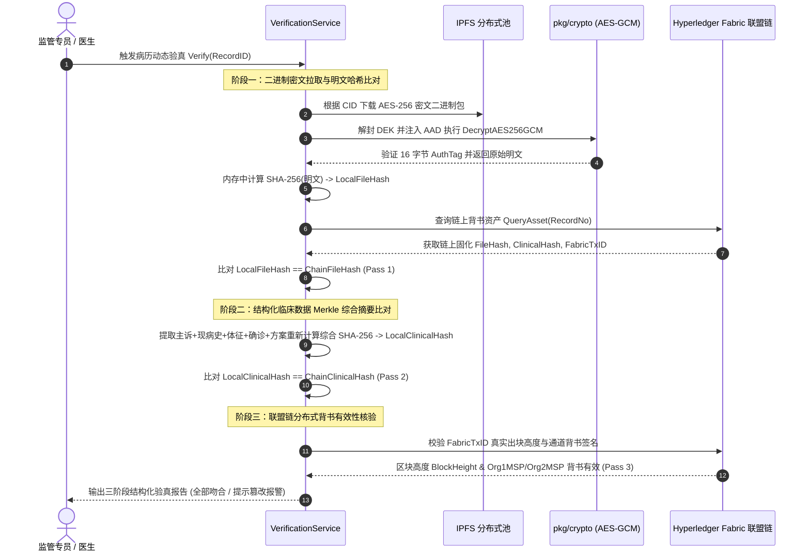
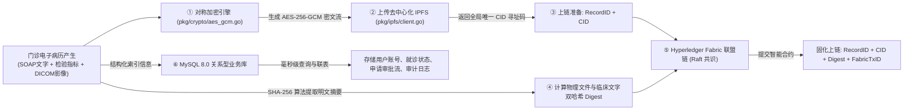

# MedTrust 系统架构全景剖析、核心功能代码映射与重点算法深度手册

> [!NOTE]
> **毕业设计答辩专属权威手册**：文内严格对齐项目真实源码（100% 杜绝虚构路径或失效函数名）。涵盖系统宏观架构、微服务与端口分配、**13 项核心业务功能到代码文件/行号的全量映射**、**6 大重点核心算法的数学建模与代码实现剖析**、以及 MySQL 8.0 + IPFS + Fabric 三模存储机制。
> 答辩时如遇老师提问“XX 功能在哪实现”、“XX 算法数学公式和代码逻辑是什么”，可直接对照本手册答复。

---

## 🏛️ 一、 系统全貌与技术架构（工业级分层模型）

本项目全称为**“基于区块链与零信任的跨机构医疗数据可信协同与隐私保护系统”**（代号 **MedTrust**）。系统采用现代化前后端分离与微服务协同架构，由以下核心分层构成：

```mermaid
flowchart TD
    subgraph Client["用户终端 / 前端视图层 (Vue 3 + TypeScript + Vite + Pinia + Element Plus)"]
        UI_Doc["门诊医生工作台 / 跨院调阅端"]
        UI_Pat["患者知情同意 / 授权撤回大厅"]
        UI_Sup["卫健监管全景大屏 / 验真靶场"]
        UI_Adm["机构科室运维 / 字典管理端"]
    end

    subgraph Gateway["API 路由与安全中间件 (Go Gin Engine 端口 8080)"]
        MW_CORS["CORS 跨域安全中间件 (cors.go)"]
        MW_JWT["JWT Bearer 身份鉴权 (jwt.go)"]
        MW_Role["RBAC 角色权限守卫 (roles.go)"]
        Router["84 个标准 RESTful 路由网关 (router.go)"]
    end

    subgraph ServiceLayer["核心业务服务层 (Go Backend Services)"]
        S_Auth["身份认证服务 AuthService (auth_service.go)"]
        S_Enc["门诊接诊闭环 EncounterService (encounter_service.go)"]
        S_Up["病历上链服务 MedicalUploadService (medical_upload_service.go)"]
        S_Risk["零信任风控引擎 AccessEngine (access_engine.go)"]
        S_Emer["急救破窗通道 EmergencyService (emergency_service.go)"]
        S_Veri["三阶段验真 VerificationService (verification_service.go)"]
        S_Inf["高危院感预警 InfectionService (infection_service.go)"]
        S_AIDiag["AI 代理网关 AIDiagnosticService (ai_diagnostic_service.go)"]
    end

    subgraph MicroAI["受控辅助智能微服务 (Python FastAPI 端口 8000)"]
        AI_Gate["Single Gatekeeper 安全网关 (main.py)"]
        AI_Agent["提示词防注入与受控 Agent (agent.py)"]
        AI_Tools["受控工具集 ControlledMedicalTools (tools.py)"]
    end

    subgraph StorageLayer["三模安全持久化与联盟链账本层"]
        DB_SQL[("关系型业务主库 MySQL 8.0 (端口 3306)\n存储用户、科室、就诊状态、申请单、审计流")]
        IPFS_Pool[("IPFS 去中心化密文存储池 (端口 5001)\n存储 AES-256-GCM 加密病历密文包与 DICOM 影像附件")]
        Fabric_Ledger[("Hyperledger Fabric 2.5 联盟链 (端口 7051)\n不可篡改数字指纹、IPFS CID、授权存证与链码背书")]
    end

    UI_Doc & UI_Pat & UI_Sup & UI_Adm -->|HTTP / RESTful API| MW_CORS
    MW_CORS --> MW_JWT --> MW_Role --> Router
    Router --> ServiceLayer
    S_AIDiag <-->|HTTP POST 8000 (携带 JWT Token)| AI_Gate
    AI_Gate --> AI_Agent --> AI_Tools
    AI_Tools -.->|受控回调 8080 API| Router
    ServiceLayer --> DB_SQL
    ServiceLayer --> IPFS_Pool
    ServiceLayer --> Fabric_Ledger
```

### 微服务与端口分配清单

| 组件名称 | 运行环境 / 核心技术栈 | 默认端口 | 职责定位 |
| :--- | :--- | :--- | :--- |
| **前端应用** | Node.js 18+ / Vue 3 + Vite + Element Plus | **`5173`** | 提供医生、患者、监管专员、系统管理员 4 类角色的现代化交互工作台 |
| **Go 核心业务网关** | Go 1.21+ / Gin + GORM | **`8080`** | 系统中枢：负责 JWT 鉴权、零信任风控、三模数据持久化、密码学运算与路由分发 |
| **受控 AI Agent 服务** | Python 3.10+ / FastAPI + Pydantic v2 | **`8000`** | 跨院多期病历 SOAP 结构化摘要提炼与隐匿线索识别（坚决不直连底层数据库） |
| **Fabric 联盟链节点** | Docker / Hyperledger Fabric 2.5 (Raft) | **`7051 / 7050`** | 提供多医院节点背书，运行 `medical_contract` 智能合约链码 |
| **关系型业务数据库** | MySQL 8.0 (InnoDB) | **`3306`** | 存储结构化业务实体、流程状态、索引目录、知情同意策略与操作日志 |
| **IPFS 分布式节点** | Kubo / Go-IPFS (支持本地容灾目录适配) | **`5001 / 8080`** | 存储经对称加密后的电子病历二进制流及医学影像大文件 |

---

## 🎯 二、 核心业务功能与代码文件/函数全量映射表

本表严格依据实际工程代码核对，**绝无虚构文件或过时函数名**：

| 业务功能模块 | 前端视图与组件 (Vue 3) | 后端控制器 (Controller) | 核心业务服务 (Service) | 底层基础设施与工具 (Pkg / Repo) |
| :--- | :--- | :--- | :--- | :--- |
| **1. 用户登录与算术防爆破验证码** | [LoginView.vue](file:///e:/EnglishEncoding/competition/last/MedTrust/frontend/src/views/LoginView.vue)<br>[api/auth.ts](file:///e:/EnglishEncoding/competition/last/MedTrust/frontend/src/api/auth.ts) | [`AuthController.Login`](file:///e:/EnglishEncoding/competition/last/MedTrust/backend/controller/auth_controller.go#L39)<br>[`AuthController.GetCaptcha`](file:///e:/EnglishEncoding/competition/last/MedTrust/backend/controller/auth_controller.go#L31) | [`AuthService.Login`](file:///e:/EnglishEncoding/competition/last/MedTrust/backend/service/auth_service.go#L32) | [`UserRepository.FindByUsername`](file:///e:/EnglishEncoding/competition/last/MedTrust/backend/repository/user_repo.go#L18)<br>[pkg/captcha/captcha.go](file:///e:/EnglishEncoding/competition/last/MedTrust/backend/pkg/captcha/captcha.go) |
| **2. 门诊初诊录入与医技检查开单** | [DoctorRecordsView.vue](file:///e:/EnglishEncoding/competition/last/MedTrust/frontend/src/views/doctor/DoctorRecordsView.vue)<br>[api/medical.ts](file:///e:/EnglishEncoding/competition/last/MedTrust/frontend/src/api/medical.ts) | [`MedicalController.CreateEncounterInitial`](file:///e:/EnglishEncoding/competition/last/MedTrust/backend/controller/medical_controller.go#L107) | [`MedicalEncounterService.CreateEncounterInitial`](file:///e:/EnglishEncoding/competition/last/MedTrust/backend/service/encounter_service.go#L23) | [`MedicalRepository.CreateRecord`](file:///e:/EnglishEncoding/competition/last/MedTrust/backend/repository/medical_repo.go#L44)<br>[`MedicalRepository.CreateExamOrder`](file:///e:/EnglishEncoding/competition/last/MedTrust/backend/repository/medical_repo.go#L173) |
| **3. 医技中心报告出具与影像归档** | [LabCenterView.vue](file:///e:/EnglishEncoding/competition/last/MedTrust/frontend/src/views/doctor/LabCenterView.vue)<br>[api/medical.ts](file:///e:/EnglishEncoding/competition/last/MedTrust/frontend/src/api/medical.ts) | [`MedicalController.CompleteExamOrder`](file:///e:/EnglishEncoding/competition/last/MedTrust/backend/controller/medical_controller.go#L182) | [`MedicalEncounterService.CompleteExamOrder`](file:///e:/EnglishEncoding/competition/last/MedTrust/backend/service/encounter_service.go#L108) | [`MedicalRepository.UpdateExamOrder`](file:///e:/EnglishEncoding/competition/last/MedTrust/backend/repository/medical_repo.go#L185)<br>[pkg/ipfs/client.go](file:///e:/EnglishEncoding/competition/last/MedTrust/backend/pkg/ipfs/client.go) |
| **4. 门诊确诊、AES-256 加密与上链存证** | [DoctorRecordsView.vue](file:///e:/EnglishEncoding/competition/last/MedTrust/frontend/src/views/doctor/DoctorRecordsView.vue) | [`MedicalController.CompleteEncounterFinal`](file:///e:/EnglishEncoding/competition/last/MedTrust/backend/controller/medical_controller.go#L143) | [`MedicalUploadService.UploadRecord`](file:///e:/EnglishEncoding/competition/last/MedTrust/backend/service/medical_upload_service.go#L30) | [pkg/crypto/aes_gcm.go](file:///e:/EnglishEncoding/competition/last/MedTrust/backend/pkg/crypto/aes_gcm.go)<br>[pkg/blockchain/fabric_gateway.go](file:///e:/EnglishEncoding/competition/last/MedTrust/backend/pkg/blockchain/fabric_gateway.go) |
| **5. 跨机构病历零信任动态风控评估** | [CrossQueryView.vue](file:///e:/EnglishEncoding/competition/last/MedTrust/frontend/src/views/doctor/CrossQueryView.vue)<br>[api/access.ts](file:///e:/EnglishEncoding/competition/last/MedTrust/frontend/src/api/access.ts) | [`AccessRequestController.RequestAccess`](file:///e:/EnglishEncoding/competition/last/MedTrust/backend/controller/access_request_controller.go#L25) | [`AccessEngine.EvaluateAccess`](file:///e:/EnglishEncoding/competition/last/MedTrust/backend/service/access_engine.go#L30) | [pkg/risk/risk_engine.go](file:///e:/EnglishEncoding/competition/last/MedTrust/backend/pkg/risk/risk_engine.go)<br>[`AuthPolicyRepository`](file:///e:/EnglishEncoding/competition/last/MedTrust/backend/repository/auth_policy_repo.go) |
| **6. 患者在场专属密钥现场即时解锁** | [CrossQueryView.vue](file:///e:/EnglishEncoding/competition/last/MedTrust/frontend/src/views/doctor/CrossQueryView.vue)<br>[PatientEmergencySearchView.vue](file:///e:/EnglishEncoding/competition/last/MedTrust/frontend/src/views/doctor/PatientEmergencySearchView.vue) | [`KeyUnlockController.UnlockByKey`](file:///e:/EnglishEncoding/competition/last/MedTrust/backend/controller/key_unlock_controller.go#L179)<br>[`KeyUnlockController.UnlockPatientByKey`](file:///e:/EnglishEncoding/competition/last/MedTrust/backend/controller/key_unlock_controller.go#L66) | [`AuthService.VerifyMedicalKey`](file:///e:/EnglishEncoding/competition/last/MedTrust/backend/service/auth_service.go#L605) | [`UserRepository.VerifyMedicalKeyHash`](file:///e:/EnglishEncoding/competition/last/MedTrust/backend/repository/user_repo.go#L142)<br>[pkg/crypto/aes_gcm.go](file:///e:/EnglishEncoding/competition/last/MedTrust/backend/pkg/crypto/aes_gcm.go) |
| **7. 昏迷急救 Break-Glass 破窗通道** | [PatientEmergencySearchView.vue](file:///e:/EnglishEncoding/competition/last/MedTrust/frontend/src/views/doctor/PatientEmergencySearchView.vue)<br>[CrossQueryView.vue](file:///e:/EnglishEncoding/competition/last/MedTrust/frontend/src/views/doctor/CrossQueryView.vue) | [`EmergencyAccessController.BreakGlass`](file:///e:/EnglishEncoding/competition/last/MedTrust/backend/controller/emergency_access_controller.go#L24)<br>[`EmergencyAccessController.EmergencyBatchAccess`](file:///e:/EnglishEncoding/competition/last/MedTrust/backend/controller/emergency_access_controller.go#L95) | [`EmergencyService.SubmitEmergencyAccess`](file:///e:/EnglishEncoding/competition/last/MedTrust/backend/service/emergency_service.go#L30) | [`EmergencyRepository.CreateEvent`](file:///e:/EnglishEncoding/competition/last/MedTrust/backend/repository/emergency_repo.go#L16)<br>[pkg/blockchain/fabric_gateway.go](file:///e:/EnglishEncoding/competition/last/MedTrust/backend/pkg/blockchain/fabric_gateway.go) |
| **8. 患者急救事后异议与监管处罚闭环** | [EmergencyNoticeView.vue](file:///e:/EnglishEncoding/competition/last/MedTrust/frontend/src/views/patient/EmergencyNoticeView.vue)<br>[EmergencyAuditView.vue](file:///e:/EnglishEncoding/competition/last/MedTrust/frontend/src/views/supervisor/EmergencyAuditView.vue) | [`EmergencyAccessController.PatientFeedback`](file:///e:/EnglishEncoding/competition/last/MedTrust/backend/controller/emergency_access_controller.go#L163)<br>[`SupervisorController.AuditEmergencyEvent`](file:///e:/EnglishEncoding/competition/last/MedTrust/backend/controller/supervisor_controller.go#L178) | [`EmergencyService.SubmitPatientFeedback`](file:///e:/EnglishEncoding/competition/last/MedTrust/backend/service/emergency_service.go#L100)<br>[`EmergencyService.AuditEvent`](file:///e:/EnglishEncoding/competition/last/MedTrust/backend/service/emergency_service.go#L125) | [`EmergencyRepository.UpdateEventFeedback`](file:///e:/EnglishEncoding/competition/last/MedTrust/backend/repository/emergency_repo.go#L54)<br>[`UserRepository.UpdateUserStatus`](file:///e:/EnglishEncoding/competition/last/MedTrust/backend/repository/user_repo.go#L87) |
| **9. 患者自主知情同意与授权撤回** | [PatientRecordsView.vue](file:///e:/EnglishEncoding/competition/last/MedTrust/frontend/src/views/patient/PatientRecordsView.vue)<br>[AuthManagerView.vue](file:///e:/EnglishEncoding/competition/last/MedTrust/frontend/src/views/patient/AuthManagerView.vue) | [`AccessPolicyController.SetRecordAccessPolicy`](file:///e:/EnglishEncoding/competition/last/MedTrust/backend/controller/access_policy_controller.go#L24)<br>[`AuthorizationRevokeController.RevokeAuthorization`](file:///e:/EnglishEncoding/competition/last/MedTrust/backend/controller/authorization_revoke_controller.go#L24) | [`MedicalEncounterService.SetAccessPolicy`](file:///e:/EnglishEncoding/competition/last/MedTrust/backend/service/encounter_service.go#L160) | [`AuthPolicyRepository.CreateAuthorization`](file:///e:/EnglishEncoding/competition/last/MedTrust/backend/repository/auth_policy_repo.go#L44)<br>[pkg/blockchain/fabric_gateway.go](file:///e:/EnglishEncoding/competition/last/MedTrust/backend/pkg/blockchain/fabric_gateway.go) |
| **10. 链上数据三阶段验真与防篡改演示** | [VerifyView.vue](file:///e:/EnglishEncoding/competition/last/MedTrust/frontend/src/views/supervisor/VerifyView.vue)<br>[RecordIntegrityDialog.vue](file:///e:/EnglishEncoding/competition/last/MedTrust/frontend/src/components/RecordIntegrityDialog.vue) | [`SupervisorController.VerifyRecord`](file:///e:/EnglishEncoding/competition/last/MedTrust/backend/controller/supervisor_controller.go#L210)<br>[`SupervisorController.SimulateTamper`](file:///e:/EnglishEncoding/competition/last/MedTrust/backend/controller/supervisor_controller.go#L235) | [`VerificationService.Verify`](file:///e:/EnglishEncoding/competition/last/MedTrust/backend/service/verification_service.go#L51)<br>[`VerificationService.SimulateTamper`](file:///e:/EnglishEncoding/competition/last/MedTrust/backend/service/verification_service.go#L201) | [pkg/crypto/aes_gcm.go](file:///e:/EnglishEncoding/competition/last/MedTrust/backend/pkg/crypto/aes_gcm.go)<br>[pkg/blockchain/fabric_gateway.go](file:///e:/EnglishEncoding/competition/last/MedTrust/backend/pkg/blockchain/fabric_gateway.go) |
| **11. 跨院病历 SOAP 摘要与隐匿线索提取** | [AiDiagnosticDialog.vue](file:///e:/EnglishEncoding/competition/last/MedTrust/frontend/src/components/AiDiagnosticDialog.vue)<br>[api/ai.ts](file:///e:/EnglishEncoding/competition/last/MedTrust/frontend/src/api/ai.ts) | [`MedicalController.DiagnosticAssist`](file:///e:/EnglishEncoding/competition/last/MedTrust/backend/controller/medical_controller.go#L47) | [`AIDiagnosticService.DiagnosticAssist`](file:///e:/EnglishEncoding/competition/last/MedTrust/backend/service/ai_diagnostic_service.go#L45) | [ai_agent/main.py](file:///e:/EnglishEncoding/competition/last/MedTrust/ai_agent/main.py)<br>[ai_agent/agent.py](file:///e:/EnglishEncoding/competition/last/MedTrust/ai_agent/agent.py)<br>[ai_agent/tools.py](file:///e:/EnglishEncoding/competition/last/MedTrust/ai_agent/tools.py) |
| **12. 医护职业安全防范与高危院感预警** | [InfectionSafetyAlert.vue](file:///e:/EnglishEncoding/competition/last/MedTrust/frontend/src/components/InfectionSafetyAlert.vue) | [`MedicalController.GetPatientInfectionRisks`](file:///e:/EnglishEncoding/competition/last/MedTrust/backend/controller/medical_controller.go#L92) | [`InfectionService.AnalyzePatientRisks`](file:///e:/EnglishEncoding/competition/last/MedTrust/backend/service/infection_service.go#L370) | [frontend/src/utils/infectionGuard.ts](file:///e:/EnglishEncoding/competition/last/MedTrust/frontend/src/utils/infectionGuard.ts) |
| **13. 符合卫健规范的 PDF 存证出具** | [DoctorRecordsView.vue](file:///e:/EnglishEncoding/competition/last/MedTrust/frontend/src/views/doctor/DoctorRecordsView.vue)<br>[AuthManagerView.vue](file:///e:/EnglishEncoding/competition/last/MedTrust/frontend/src/views/patient/AuthManagerView.vue) | [`MedicalController.Download`](file:///e:/EnglishEncoding/competition/last/MedTrust/backend/controller/medical_controller.go#L70) | [`MedicalService.DecryptFileAndComputeHash`](file:///e:/EnglishEncoding/competition/last/MedTrust/backend/service/medical_query_service.go#L110) | [pkg/pdf/pdf_generator.go](file:///e:/EnglishEncoding/competition/last/MedTrust/backend/pkg/pdf/pdf_generator.go) (PDF 1.4 原生流式渲染) |

---

## 🧮 三、 6 大重点核心算法深度剖析与数学建模

> [!IMPORTANT]
> **毕业论文与答辩的核心加分项**：下述算法均具备清晰的数学逻辑与生产级代码实现，绝非黑盒调用。

### 算法 1：零信任动态加权风险评估算法 (Zero-Trust Weighted Risk Evaluation)

- **核心代码定位**：[backend/pkg/risk/risk_engine.go](file:///e:/EnglishEncoding/competition/last/MedTrust/backend/pkg/risk/risk_engine.go#L79-L339)
- **数学建模公式**：
  设每次调阅请求由 $n=7$ 个异构安全因子评估，综合风险评分 $R \in [0, 100]$ 的计算公式为：
  $$R = \min\left(100, \sum_{i=1}^{7} w_i \cdot \mathbb{I}(\text{Rule}_i)\right)$$
  其中 $\mathbb{I}(\text{Rule}_i) \in \{0, 1\}$ 为规则指示函数（触发为 1，否则为 0），$w_i$ 为对应规则的安全风险权值。

- **7 项规则权值矩阵清单**：
  | 规则编号 | 规则名称 | 触发条件指示函数 $\mathbb{I}(\text{Rule}_i) = 1$ | 权值 $w_i$ | 规则说明与防范意图 |
  | :--- | :--- | :--- | :--- | :--- |
  | **RULE-D1** | 跨医疗机构调阅 | `isCrossHospital == true` | **15** | 调阅非本院就诊记录，触发跨域基础风控基线 |
  | **RULE-A1** | 患者未显式授权 | `hasConsent == false` | **30** | 患者尚未在区块链签发有效知情同意凭证 |
  | **RULE-T1** | 访问时间窗口合规 | 当前时间 $h < 8$ 或 $h \ge 18$ | **20** | 非工作时段或夜间异动调阅，防数据暗中窃取 |
  | **RULE-F1** | 5分钟同患者高频调阅 | 5分钟滑动窗口内针对同一患者调阅次数 $\ge 3$ | **25** | 疑似自动化脚本抓取或单人病历爬虫异常 |
  | **RULE-F2** | 10分钟批量多患者调阅 | 10分钟滑动窗口内访问不同患者数 $\ge 5$ | **20** | 疑似医生账号遭凭证劫持后实施批量拖库 |
  | **RULE-H1** | 历史违规行为追溯 | 30天内存在被监管裁决为违规的破窗记录 | **35** | 历史失信医生动态提升调阅审查门槛 |
  | **RULE-S1** | 医生账号监管状态 | 医生账号当前状态等于 `RESTRICTED` | **30** | 受到降级通报处分的医生从严管控 |

- **多级安全决策策略**：
  - **$R < 30$（低风险 LOW）**：执行 `DIRECT_ALLOW`，放行病历解密展示；
  - **$30 \le R < 60$（中风险 MEDIUM）**：执行 `NEED_PATIENT_CONFIRM`，系统阻断直接透视，强制要求患者现场提供**专属调阅密钥**或在患者端在线确认；
  - **$R \ge 60$（高风险 HIGH）**：执行 `REJECT_AND_ALARM`，系统强制阻断调阅请求，并向监管端与系统审计流实时广播高危安全警报；
  - **特权分支（Break-Glass 破窗）**：当且仅当经治医生选择抢救生命体征危急时，设置 `isEmergency = true`，系统跳过加权累加，标记为 `BREAK_GLASS_EXEMPTION` 并执行即时放行与全流程上链追责。

---

### 算法 2：基于 AAD 强绑定的 AES-256-GCM 密文信封加密与防篡改算法

- **核心代码定位**：[backend/pkg/crypto/aes_gcm.go](file:///e:/EnglishEncoding/competition/last/MedTrust/backend/pkg/crypto/aes_gcm.go#L124-L215)
- **解决的痛点**：普通对称加密容易遭受“密文剪切重放攻击”（即黑客将患者 A 的合法加密附件直接复制替换为患者 B 的病历附件）。
- **密码学工程实现原理**：
  1. **数据加密密钥（DEK）生成**：对每一份病历，调用 `crypto/rand` 随机生成全局唯一的 256 位 $\text{DEK} \leftarrow \{0,1\}^{256}$ 以及 96 位初始化向量 $\text{IV} \leftarrow \{0,1\}^{96}$。
  2. **附加认证数据（AAD）绑定**：
     $$\text{AAD} = \text{"patient:"} \mathbin{\Vert} \text{PatientID} \mathbin{\Vert} \text{"\|record:"} \mathbin{\Vert} \text{RecordNo}$$
     将患者主键 ID 与病历唯一流水号打包注入 Galois 乘法域。即使密文流本身未被篡改，一旦黑客试图将该密文包绑定到另一个患者名下，解密时 AAD 比对失败将直接引发 GMAC 报错！
  3. **密文与 16 字节 AuthTag 封装**：
     $$(\text{Ciphertext}, \text{AuthTag}) = \text{AES-GCM-Seal}(\text{DEK}, \text{IV}, \text{Plaintext}, \text{AAD})$$
  4. **主密钥信封保护**：
     系统使用 32 字节主密钥 $\text{MasterKey}$ 对 $\text{DEK}$ 进行二级密封，形成信封结构 $\text{SealedDEK} = \text{AES-GCM-Seal}(\text{MasterKey}, \text{Nonce}_{\text{DEK}}, \text{DEK}, \emptyset)$，密文安全上传 IPFS，数据库仅保存寻址 CID 与加密后的 SealedDEK。

---

### 算法 3：三阶段全链路闭环动态验真算法 (3-Stage Blockchain Dynamic Integrity Verification)

- **核心代码定位**：[backend/service/verification_service.go](file:///e:/EnglishEncoding/competition/last/MedTrust/backend/service/verification_service.go#L51-L199)
- **动态验真流程图**：



- **三阶段严格门禁**：
  1. **阶段一（文件物理指纹验真）**：从 IPFS 拉取密文，校验 AES-GCM 认证标签并解密，重新计算 SHA-256 必须与链上登记的 `FileHash` 逐位吻合。
  2. **阶段二（临床文字结构化 Merkle 验真）**：从业务库抽取全部文字诊断字段，重新执行多维哈希计算，与 Fabric 账本上的 `ClinicalHash` 进行比对。任何直接在数据库中修改病历文字的行为在此阶段均被秒级识破。
  3. **阶段三（分布式背书凭据验真）**：核验 Fabric 交易哈希 `FabricTxID`、区块高度 `BlockHeight` 及联盟多节点（`Org1MSP`, `Org2MSP`）的密码学数字签名。

---

### 算法 4：昏迷急救“破窗”（Break-Glass）机制与事后双向异议仲裁算法

- **核心代码定位**：[backend/service/emergency_service.go](file:///e:/EnglishEncoding/competition/last/MedTrust/backend/service/emergency_service.go#L20-L267)
- **临床矛盾**：患者昏迷无意识无法提供密码授权；若强行等待家属可能延误抢救（黄金 4 分钟）；若随意开放权限则易遭医生窥探隐私。
- **机制设计（事前放行 + 链上存证 + 事后闭环监管）**：
  1. **事前极速破窗**：
     医生提交抢救指征（如 `COMA 意识丧失`），系统瞬间签发有效期为 24 小时的专用临时授权凭证 `AUTH_EMG...`，并在内存与数据库中放行。同时，调用 `FabricService.CommitAsset` 将本次紧急调阅流水号 `EA2026...`、医生工号、调阅时间戳作为 `EMERGENCY_ACCESS` 资产**永久上链**。
  2. **事后双向监督与两道审核关卡**：
     - **关卡一（纯代码客观规则初筛 `EvaluateRulePreScreen`）**：
       - 识别是否命中急诊危重正向词库：`COMA`, `SHOCK`, `CARDIAC_ARREST`, `昏迷`, `休克`, `心跳骤停`；
       - 识别可疑负向特征：理由为 `OTHER` 或笼统文本、或者 1 小时内同医生破窗调阅超过 8 次（防批量滥用刷单）。
     - **关卡二（AI 医患陈述争议对比辅助提炼 `GenerateAuditComparisonSummary`）**：
       - 患者醒来后在客户端查看破窗记录并提交异议（如声称“当时神志清醒”或“并未去过该医院”）；
       - AI 提取医患两端陈述，梳理出【就诊真实性分歧】与【知情程序合规分歧】，生成争议摘要供卫健专员审阅。
  3. **监管惩戒联动**：
     卫健监管专员核验急诊真实心电图或病程记录。一旦判定医生违规，调用 `AuditEvent()` 将医生系统状态修改为 `RESTRICTED` 并更新链上资产，即刻限制其跨院调阅权限；申诉成功后亦可一键调用 `LiftDoctorRestriction()` 恢复其执业资质。

---

### 算法 5：医护职业暴露与高危院感正则敏感词流式扫描算法 (Infection Risk Guard)

- **核心代码定位**：
  - 后端：[backend/service/infection_service.go](file:///e:/EnglishEncoding/competition/last/MedTrust/backend/service/infection_service.go#L43-L370)
  - 前端：[frontend/src/utils/infectionGuard.ts](file:///e:/EnglishEncoding/competition/last/MedTrust/frontend/src/utils/infectionGuard.ts)
- **业务意义**：保护一线接诊医生的职业安全，在医生接触患者前，自动跨院扫描既往所有历史病历中的传染病史。
- **6 类重大传染病全量匹配规则库**：
  | 传染病分类 | 疾病名称 | 携带属性 | 危险等级 | 核心匹配关键词 (不区分大小写正则) | 医护防护装备建议 (PPE) |
  | :--- | :--- | :--- | :--- | :--- | :--- |
  | **血源传播** | 艾滋病 (HIV/AIDS) | 终身携带 | **CRITICAL** | `hiv`, `aids`, `人类免疫缺陷`, `hiv抗体阳性`, `hiv-ab(+)` | N95 口罩、双层乳胶手套、防喷溅面屏、防渗透隔离衣；备 PEP 阻断药 |
  | **血源传播** | 慢性乙型肝炎 (HBV) | 长期携带 | **HIGH** | `乙肝`, `hbv`, `hbsag(+)`, `大三阳`, `小三阳`, `乙肝病毒携带` | 医用外科口罩、双层乳胶手套；需确认抗-HBs 滴度 $\ge 10\text{ mIU/mL}$ |
  | **血源传播** | 慢性丙型肝炎 (HCV) | 长期慢性化 | **HIGH** | `丙肝`, `hcv`, `抗-hcv(+)`, `hcv-rna阳性` | 医用外科口罩、乳胶手套、防溅眼罩；备 DAA 抗病毒药物 |
  | **空气气溶胶** | 活动性肺结核 (TB) | 持续排菌 | **HIGH** | `肺结核`, `活动性结核`, `结核分枝杆菌`, `mdr-tb`, `涂阳` | 密合型 N95 医用防护口罩、负压层流病房 (换气 $\ge 12\text{ ACH}$) |
  | **黏膜接触** | 梅毒 (Syphilis) | 持续感染 | **MEDIUM_HIGH** | `梅毒`, `tppa阳性`, `rpr阳性`, `trust阳性`, `硬下疳` | 接触全流程佩戴乳胶手套，严禁手部有皮损直接查体；备苄星青霉素 |
  | **接触定植** | 超级耐药菌 (CRE/MRSA) | 长期定植 | **MEDIUM_HIGH** | `耐碳青霉烯`, `cre`, `mrsa`, `耐甲氧西林`, `泛耐药鲍曼` | 接触隔离、一次性防护服与手套、一人一用专用听诊器与体温计 |

---

### 算法 6：受控 AI Agent 提示词注入防御与 Single Gatekeeper 准入控制

- **核心代码定位**：[ai_agent/agent.py](file:///e:/EnglishEncoding/competition/last/MedTrust/ai_agent/agent.py#L9-L65)、[ai_agent/tools.py](file:///e:/EnglishEncoding/competition/last/MedTrust/ai_agent/tools.py)
- **医疗合规红线**：国家卫健委《人工智能医用软件准入指南》严禁 AI 擅自替代医生做出最终确诊或开具处方。
- **核心安全机制设计**：
  1. **Single Gatekeeper 原则**：Python FastAPI AI 微服务中**坚决不引入任何 MySQL、IPFS 或 Fabric 驱动依赖**。AI 想要查询任何数据，必须通过工具调用（Tool Calling）携带前端传来的合法用户 JWT Bearer Token 回调 Go 后端 API（Port 8080）。后端对 AI 触发的每一次调用执行同等的 RBAC、ABAC 与风控规则过滤。
  2. **提示词越狱探测与注入防御**：
     内置对抗模式正则表达式（匹配 `ignore previous instructions`, `bypass rules`, `越狱`, `开发者模式` 等模式）。一旦触发注入探测，直接阻断并记录安全审计。
  3. **输出脱敏引擎 (`sanitize_agent_output`)**：
     对 AI 返回的所有对话文本实施二次正则清洗：
     - JWT Bearer 令牌：清洗为 `[JWT_TOKEN_MASKED]`；
     - 大陆手机号（11 位）：清洗为前 3 后 4 脱敏 `138****1234`；
     - 居民身份证（18 位）：清洗为 `420106********1234`；
     - 系统密钥或密码特征：强制替换为 `********`。

---

## 💾 四、 “三模协同”数据持久化架构深度解析



### 老师提问：“为什么不能把病历数据全部存进区块链？”

> **答辩标准满分回答话术**：
> “报告老师，我们在系统设计中严格遵循了区块链工程规范：
> 1. **解决‘区块链膨胀’难题**：医疗数据尤其是医学影像（CT/MRI/DICOM）体量动辄数 MB 乃至数百 MB。如果将大文件直接写入区块链，账本在多节点共识下会呈几何级数膨胀，导致节点同步严重卡死（链上臃肿瓶颈）。
> 2. **解决‘关系型联表查询’难题**：区块链账本底层本质是基于键值的状态数据库（LevelDB/CouchDB），无法支持像 `JOIN`、范围筛选、分页检索以及动态聚合统计等高频医疗业务需求。
> 3. **架构最佳实践**：因此，我们采用了‘三模协同’分工方案——
>    - **MySQL 8.0** 负责日常高频毫秒级事务、账号认证与流程状态流转；
>    - **IPFS 分布式池** 存储经 **AES-256-GCM** 加密的高安全性大文件密文；
>    - **Hyperledger Fabric 联盟链** 专门存储**不可篡改的数字指纹（SHA-256）、IPFS CID 索引与访问审计存证**。三者协同互补，既保证了隐私性与海量吞吐量，又实现了防篡改和多院信任公证。”

---

## 🛡️ 五、 答辩通关高频核心 Q&A（背诵要点）

### Q1：你们的零信任风控引擎具体是怎么在代码里运行的？
> **参考回答**：
> “零信任风控由 Go 后端的 [backend/pkg/risk/risk_engine.go](file:///e:/EnglishEncoding/competition/last/MedTrust/backend/pkg/risk/risk_engine.go) 驱动。当医生在前端发起跨院病历调阅时，控制器调用 `EvaluateAccess` 方法，将当前请求上下文输入规则引擎。
> 引擎基于 7 项规则计算综合风险加权分（满分 100 分）：包括跨院行为基础分 15 分、患者未在线授权 30 分、夜间调阅 20 分、同患者高频访问 25 分、批量拖库特征 20 分等。
> - 低于 30 分时系统予以直接放行；
> - 30 到 60 分之间为中风险，系统阻断直接透视，要求患者在场输入专属密码即时授权；
> - 超过 60 分为高风险，系统强制阻断并触发声光预警。”

### Q2：如果数据库被攻击者篡改了，你们系统是如何用区块链发现的？
> **参考回答**：
> “我们在 [backend/service/verification_service.go](file:///e:/EnglishEncoding/competition/last/MedTrust/backend/service/verification_service.go) 中构建了三阶段闭环验真机制：
> 1. 系统从 IPFS 重新拉取密文并通过 AES-256-GCM 校验认证标签解密，重算明文 SHA-256 指纹；
> 2. 从 MySQL 数据库中提取当前病历的全部临床字段重新计算临床 Merkle 哈希；
> 3. 调用 Fabric 智能合约读取当年多医院节点背书固化的原始指纹进行密码学比对。
> 只要本地数据库中的文字或 IPFS 密文被篡改哪怕 1 个字节，由于雪崩效应，新计算出的哈希值与区块链上存证的哈希必然不匹配，系统靶场会秒级亮起红色警报。”

### Q3：急诊昏迷抢救时患者无法输入密码，怎么救人？被医生滥用了怎么办？
> **参考回答**：
> “系统设计了合规的 **Break-Glass 破窗通道**（源码位于 [backend/service/emergency_service.go](file:///e:/EnglishEncoding/competition/last/MedTrust/backend/service/emergency_service.go)）：
> 1. 抢救时，经治医生勾选责任声明后，系统签发 24 小时临时急救授权，并秒级解密病历与致命过敏史；
> 2. 同时，系统自动将本次破窗调阅事件作为 `EMERGENCY_ACCESS` 存证资产写入 Fabric 联盟链，无法删除或抵赖；
> 3. 患者清醒后若有异议，可在系统一键提起申诉；监管端利用 AI 提炼医患争议焦点，并结合急诊抢救客观证据展开人工裁决；
> 4. 若查实医生滥用破窗，监管人员可在系统一键将其置为 `RESTRICTED` 降级受限状态，真正实现‘临床救人为先，事后闭环问责’。”

---

*MedTrust 医疗数据跨机构可信协同与隐私保护系统 · 答辩知识资产与算法设计白皮书*
